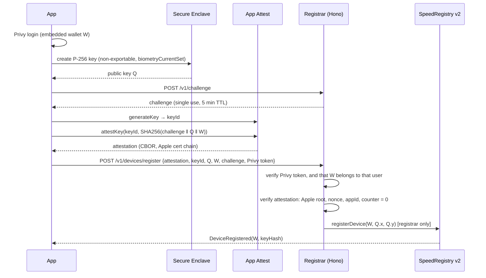

# Device identity and signed checkpoints (Tier 1 design)

This design addresses F1, F2, F6, F7, F8 and F11 from the [security triage](security-triage.md). They share one root cause: nothing proves which device produced a checkpoint, or when.

## Goal

A third party holding a checkpoint should be able to check, trusting only the registrar's registration decision:

1. It was signed by a hardware key that can't leave a specific iPhone.
2. That key was attested by Apple as belonging to a genuine device running this app, and bound to one user.
3. It was submitted within minutes of the window it describes, and nothing was inserted before it or removed.

## Non-goals (stated up front)

- **The enclave signs whatever the app hands it.** A jailbroken phone running a hooked app, or a spoofed GPS feed, can still produce correctly signed false data. App Attest makes this harder. It doesn't make it impossible. No evidence claim should go further than this.
- **iOS only.** Android (Play Integrity, StrongBox) is out of scope; there is no Android code path, so the app cannot register or sign on Android at all.
- **App Attest covers the app binary, not its JavaScript.** Apple attests the App Attest key and that it belongs to a genuine install of this app. The enclave key is bound to it only through the attested `clientDataHash`, which the app's JavaScript computes. A development build, or a modified bundle on a jailbroken phone, can therefore get a genuinely attested key that signs fabricated data. Closing this needs release builds in the production App Attest environment, checkpoints built natively, and App Attest assertions per drive or per checkpoint.
- **No gasless relayer yet.** The design allows one, because signatures don't depend on `msg.sender`, but the wallet still pays gas.

## Components

| Component | Role | Trusted for |
| --- | --- | --- |
| **Secure Enclave key** (P-256, per device) | Signs every checkpoint | Never leaves the device |
| **App Attest** (`DCAppAttestService`) | Apple's statement that a key belongs to a genuine device running this app (`teamID.bundleID`) | Device and app genuineness, at registration |
| **Registrar server** (Bun + Hono) | Verifies App Attest and the Privy session, then registers the device key on chain | Registration only, never individual checkpoints |
| **SpeedRegistry v2** (contract) | Stores registered keys and verifies every checkpoint's P-256 signature, sequence and freshness | Ordering and time (`block.timestamp`) |

The server's role is deliberately narrow. Once a key is registered, checkpoints are verified on chain against that key, so a verifier only has to trust the registration itself. That trust is real and not yet auditable: the registrar's key can register, replace or revoke any wallet's key, and the attestation it checked stays in its private database. Publishing an attestation hash on chain, requiring the old key or a wallet signature to rotate, and a timelock on replacement would narrow it.

## Sign-up and device registration



Binding `Q` and `W` into the attested `clientDataHash` is what links the three identities together: Apple's view of the device, the enclave key, and the Privy wallet. A key attested for one wallet can't be registered to another.

**Replacing a device:** registering a new key for `W` revokes the old one and starts a new checkpoint chain. The contract also lets the registrar revoke a key directly (for a lost phone or a failed check); the server does not expose this yet.

## Signing checkpoints

Every 30 seconds the app builds the Merkle tree (Tier 2 fixes its hashing) and asks the enclave to sign this payload:

```solidity
digest = keccak256(abi.encode(
    keccak256("ChainSpeed.Checkpoint.v2"),  // domain
    chainId, registryAddress,               // no cross-chain or cross-contract replay
    W,                                      // the device's wallet
    CheckpointInput(seq, prevRoot, merkleRoot, startTime, endTime,
                    avgSpeed, maxSpeed, minSpeed, distanceMeters, recordCount)
))
```

`SpeedRegistry.checkpointDigest(W, input)` exposes the same computation, so the app can check its encoding against the contract.

The enclave signs with ECDSA P-256 (`ecdsaSignatureDigestX962SHA256`, signing the digest directly). The signature comes back DER-encoded, so the app parses it into `(r, s)` and normalizes `s` to the lower half of the curve order (OpenZeppelin rejects high-`s` signatures to prevent malleability). It then submits the checkpoint fields plus `(r, s)`.

`submitCheckpoint` accepts a checkpoint only if all of these hold:

| Check | Fixes |
| --- | --- |
| `W` has a registered, unrevoked key, and `P256.verifySolidity(digest, r, s, Q.x, Q.y)` passes | F1, F2, F8, F11 |
| `seq == lastSeq[W] + 1` and `prevRoot == lastRoot[W]` | Insertion, deletion, reordering (F19 becomes redundant) |
| `startTime >= lastEndTime[W]` and `endTime <= block.timestamp + 60s` | Overlap, future windows |
| `endTime - startTime <= 10 minutes` | A fresh `endTime` paired with a long-ago `startTime`, which would otherwise pass the freshness check |
| `minSpeed <= avgSpeed <= maxSpeed` | Internally inconsistent stats (F15) |
| distance ≤ (average speed + 5 mph) × window + 50 m | "Safe" miles at a 0 mph average (F4); the allowances absorb GPS jitter and very short windows |
| `block.timestamp - endTime <= MAX_SUBMIT_DELAY` (10 minutes) | Backdating (F7) |
| `distanceMeters <= (endTime - startTime) * 45` (about 100 mph) | Impossible distances (F4, F15) |

The app never moves a recorded window, except to absorb up to one second of rounding overlap with the previous checkpoint. A queued checkpoint older than the chain head is marked unanchored rather than re-timed; re-timing would relabel old data as new (a bug found on device; see the triage).

The trusted clock is `block.timestamp`, not the phone. A checkpoint can't describe a window that ended more than 10 minutes before it landed on chain, and the sequence and `prevRoot` chain mean it can't be slotted in behind existing ones.

Because the signature covers `W`, the contract doesn't need `msg.sender == W`. Anyone, such as a future gas relayer, can submit a valid signed checkpoint.

## Record proofs (F3, F9)

Each record is a leaf in an OpenZeppelin standard Merkle tree: `keccak256(keccak256(abi.encode(device, record)))`, where the record holds its timestamp, position, speed, accuracy and a random 32-byte salt. The device address in every leaf means a root anchored by another device cannot be used to pass these records off as its own. The salt means a disclosed proof's sibling hashes cannot be brute-forced back to coordinates. `SpeedRegistry.verifyRecord(device, root, proof, record)` checks inclusion and that the record's time falls inside the checkpoint's window.

## Biometrics (F6)

The review proposed a Face ID prompt for every signature. That's unusable and unsafe while driving. Instead:

- The enclave key's access control is `.privateKeyUsage` + `.biometryCurrentSet`, so the operating system enforces Face ID before the key can be used. A JS boolean never decides it.
- At drive start, the app evaluates Face ID once with an `LAContext` and passes that context to every signing call for the session (`kSecUseAuthenticationContext`). It invalidates the context when the drive ends.
- `biometryCurrentSet` means enrolling a new face or fingerprint invalidates the key, which forces re-registration.

The property that matters is a non-exportable key on a genuine device, verified on chain. Biometrics only adds "the owner started this drive".

## Decisions and trade-offs

1. **Verify on chain, not on the server.** The contract uses OpenZeppelin's `P256.verifySolidity`. It deliberately skips `P256.verify`, which first tries a precompile at `0x100`: on Hedera that address is a system account that consumes all forwarded gas (found on testnet; see the triage). A checkpoint costs about 540k gas on Hedera, roughly 0.8 testnet HBAR at current prices. That is acceptable for a testnet prototype. If cost matters later, the fix is submitting less often (for example, one signed checkpoint covering several minutes), not trusting the server. The alternative, the server checking each signature and co-signing a cheap secp256k1 attestation, would make the server a trusted party for every checkpoint. I'd rather pay gas than add a trusted party.
2. **Strict 10-minute freshness window.** A drive without signal can't anchor its checkpoints, and late submissions are rejected. The records stay signed locally, so they're still useful, just not anchored on chain. The alternative is accepting late checkpoints with a `late` flag and letting verifiers weigh them. I chose strict for v1 because it is simple to reason about and fully closes F7.
3. **App Attest at registration only.** Per-session assertions (the server checks an App Attest assertion at each drive start and revokes keys that stop passing) would narrow the jailbreak gap further. They're a later addition, not v1.
4. **One active key per wallet.** Supporting multiple devices per user can come later.

## Build order

1. **SpeedRegistry v2:** device registry, P-256 verification, sequence/freshness/bounds checks, and tests, including one test per attack in the review. This is fully testable locally.
2. **Registrar server** (`server/`, Bun + Hono): `/challenge`, `/register`, App Attest verification, Privy token check, `registerDevice` call, and tests with recorded attestation fixtures.
3. **Native module** (`modules/secure-enclave`, Swift, Expo Modules API): key creation, signing with an `LAContext`, public key export, App Attest. **This needs a physical iPhone to test.** Neither the Secure Enclave nor App Attest works in the simulator.
4. **App wiring:** registration on first login, signed submission, and removal of `TEECryptoService` and the `TEE-HW:` format.
